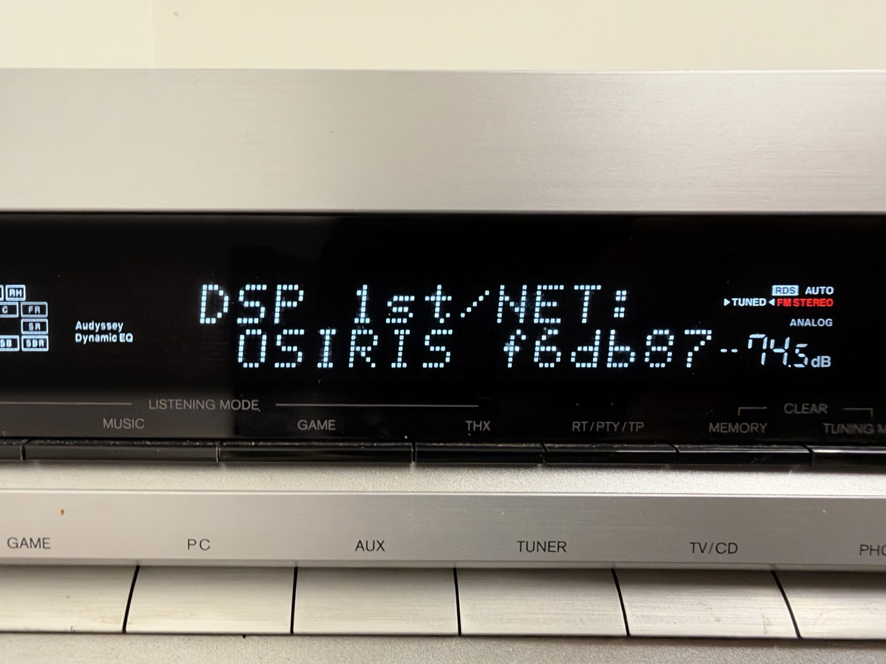

# OSIRIS

Open source firmware for Onkyo AV receivers with the TI D830 /
OMAP-L137 DSP chip - TX-NR515, TX-NR717 and friends.



If your Onkyo powers on, the display and menus work, but there's **no sound
from any input**, you've probably read about the "DTS chip" or "HDMI board"
failure. The chip is the D830 and it really does fail, but often it's the
old NAND flash with the firmware dying, and the two look exactly the same
from outside. More on what's going on and what can be done about it in
[Why Onkyo receivers lose sound](docs/no-sound.md).

OSIRIS replaces Onkyo's software on the DSP board: own first stage boot
loader (dspboot), U-Boot, Linux, own services talking to the receiver's main
MCU, and own DSP code. Front panel, remote, volume, inputs and amplifiers
keep working as before - those are run by the main MCU, OSIRIS just talks
to it the way the stock firmware did.

It runs on the original D830 and on its replacement OMAP-L137, and on old
512 byte page NAND as well as new 2K / 4K page chips you can still buy.

## Models

| model | chip | status |
|---|---|---|
| TX-NR717 | D830 (original) | works, see below |
| TX-NR515 | OMAP-L137 (swapped) | boots and runs; my board has a broken audio clock trace, so no sound yet |

The D830 is the OMAP-L137, and the D850 is the OMAP-L138.

## What works

Tested on the TX-NR717.

| feature | status |
|---|---|
| Boot from NAND (dspboot, U-Boot, Linux) | ✅ |
| Ethernet (DHCP, NTP), ssh | ✅ |
| A/B updates with fallback to previous version | ✅ |
| Updates from a USB stick through the receiver's update screens | ✅ |
| Receiver accepts the board as its DSP | ✅ |
| Model detection, hostname after model | ✅ |
| Volume, front panel, remote | ✅ (handled by the MCU) |
| Analog inputs (RCA) | ✅ |
| FM and AM radio, RDS | ✅ |
| Sound from all channels (Stereo, All Ch Stereo, Full Mono) | ✅ |
| Zones, powered speakers (analog sources such as FM) | ✅ |
| Bass and treble (front) | ✅ |
| Speaker levels | ✅ (handled by the MCU) |
| Automatic level setup (test noise) | ✅ |
| Network menu (address, MAC, name) | ✅ |
| Standby: board switched off, data synced | ✅ |
| Speaker distances (delays) | ✅ |
| Bass management (crossovers, double bass) | ✅ |
| Manual equalizer | ✅ |
| Surround from stereo in the Surround, PLII, Neo:6, Neural and THX Cinema/Music/Games modes | ✅ ¹ |
| Sound field modes (Orchestra, Unplugged, Studio-Mix, TV Logic, ...) | ✅ ¹ |
| Surround back speakers from 5.1 sources | ✅ ¹ |
| Factory reset | ❓ not tested |
| Zone line outputs, headphones | ❓ not tested |
| Subwoofer pre-out | ✅ |
| Other 7.2 pre-outs | ❓ not tested |
| Phono input | ❓ not tested |
| 12 V trigger, IR input | ❓ not tested |
| HDMI video switching, on-screen menu | ❓ not tested |
| Digital inputs (optical, coax), PCM | ❓ not tested, no sources yet |
| A/V sync | ✅ |
| Dynamic EQ, Dynamic Volume | ✅ ¹ |
| Late Night, Re-EQ, Music Optimizer, headphone downmix | ❌ not yet |
| Audyssey 2EQ | ❌ not yet |
| HDMI audio, PCM stereo and multichannel, up to 96 kHz | ✅ (5.1 tested) |
| HDMI ARC | ❌ not yet |
| Network control (Onkyo Remote app) | ❌ not yet |
| AirPlay | 🚧 in progress: plays through the DSP, the NET input not yet |
| Spotify, DLNA, internet radio, USB playback, NET menu | ❌ not yet |
| Dolby Digital / DTS decoding | ❌ not yet, the bitstreams are muted; maybe in the far future (open AC-3 / DTS core decoders like liba52 exist) |

¹ OSIRIS's own processing: it does what these features are for, but it
is not Dolby's, DTS's, THX's, Audyssey's or Onkyo's algorithm, so it
does not sound exactly like the stock firmware.

## Documentation

- [Why Onkyo receivers lose sound](docs/no-sound.md) - the D830, the NAND,
  what you can fix
- [Installing OSIRIS](docs/install.md) - what you need, building, first
  install, updates
- [Backups, recovery, stock firmware](docs/recovery.md) - backup and
  restore the stock firmware, replace NAND or the chip
- [dspboot](docs/dspboot.md) - the boot loader and repair tool
- [How OSIRIS works](docs/architecture.md) - hardware, boot, flash layout,
  services, audio path
- [Services](docs/services.md) - mcud, dspd, dspaudio, osirisd
- [MCU protocol](docs/mcu-protocol.md) - the SPI protocol between the main
  MCU and the DSP board
- [History](docs/history.md) - how this started

## Quick start

You need a serial console on the DSP board, a switch on the BOOT pins and
Docker for the build. Full steps in [docs/install.md](docs/install.md).

```sh
make dspboot      # boot loader -> dist/dspboot/
make buildroot    # U-Boot, Linux, root fs, update bundle -> dist/images/
```

**Back up your NAND first** ([how](docs/recovery.md#make-a-backup)) - with
a backup you can always go back to stock.

## Reporting problems

Open an issue and attach the output of `osiris-diag`, run on the receiver:

```sh
ssh root@TX-NR717 osiris-diag -e 30     # -e 30: also record 30 s of what the receiver sends
scp root@TX-NR717:/tmp/osiris-diag-*.tar.gz .
```

It collects versions, logs and the state of the services.

## Thanks

- **Texas Instruments** - for the datasheets, SDKs and sources. Detailed
  documentation, U-Boot, Linux and examples for the OMAP-L137 are what made
  this possible at all.
- **Onkyo** - for building feature-rich receivers that are worth bringing
  back.
- **Dolby** - no thanks. Your licensing made this a lot harder than it had
  to be: the D830 was only ever sold to Dolby licensees, so you can't even
  buy one for a repair.

## Disclaimer

Use at your own risk. Opening the receiver, soldering to the DSP board and
replacing its firmware will void the warranty, if there is any left on
these after all the years. Things can go wrong and leave a receiver that
doesn't start - keep your NAND backup.

## License

Everything written for OSIRIS (dspboot, the services, the tools and the
build) is BSD-2-Clause, see `LICENSE`. U-Boot, Linux and Buildroot,
including the changes and board files in them, stay GPL-2.0.

Not affiliated with Onkyo, Integra, Texas Instruments, Dolby or DTS.
