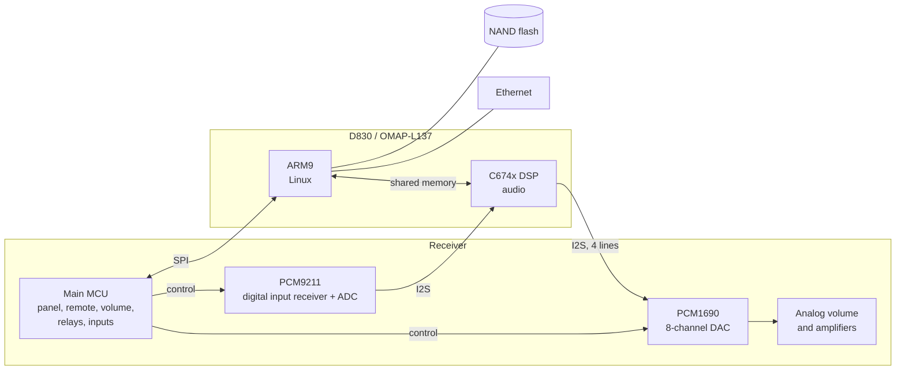
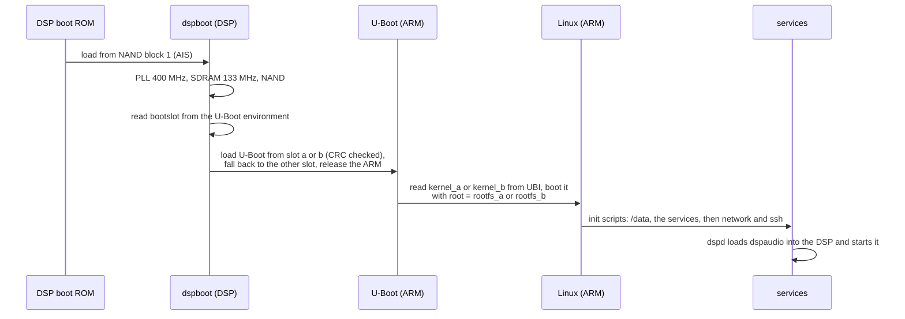
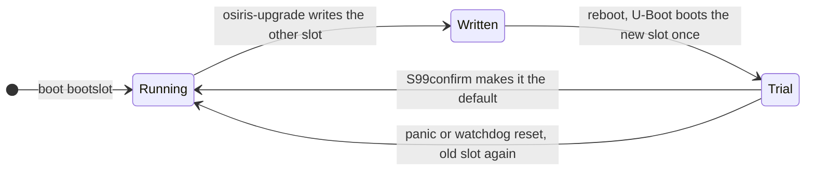
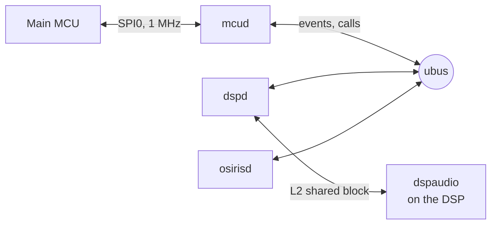
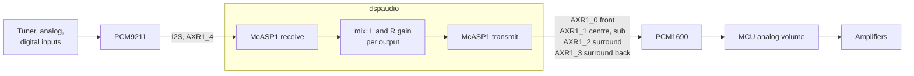

# How OSIRIS works

## The hardware

An Onkyo receiver of this generation is two computers. The **main MCU** (a
Renesas microcontroller) runs everything you touch: the front panel, the
remote, input selection, the volume, the amplifiers and the speaker relays.
The **DSP board** carries the TI D830 (or its successor, the OMAP-L137), a
chip with an ARM9 core and a C674x DSP core side by side. On the stock
firmware the DSP decodes and processes the audio, and the ARM runs Linux for
the network features and the link to the MCU.

Some things that are not obvious:

- The MCU configures the PCM9211 and the PCM1690 itself, and it applies the
  master volume in the analog stage after the DAC. The volume it sends to
  the DSP is for information only.
- The DSP drives the bit and word clocks of the outputs, but the master
  clock comes from the PCM9211.
- The MCU expects a DSP on the other end of the link. It refuses to play
  anything, and keeps the speaker relays open, until it gets the answers it
  wants. That is what mcud provides.

## Booting

On the D830 the **DSP starts first**: its boot ROM reads the first stage
from NAND, and that has to start the ARM. In the stock firmware that first
stage is Onkyo's `2ndbl`; in OSIRIS it is [dspboot](dspboot.md).

If dspboot finds neither U-Boot slot usable, it waits for one over the
serial cable (YMODEM), so a board with OSIRIS can always be brought back
without opening anything else.

### The flash

| offset | size | what |
|---|---|---|
| block 0 | 16 KiB | U-Boot environment |
| block 1 | to 1 MiB | dspboot |
| 0x100000 | 256 KiB | U-Boot environment, second copy |
| 0x140000 | 512 KiB | U-Boot, slot a |
| 0x1C0000 | 512 KiB | U-Boot, slot b |
| 0x240000 | rest | UBI: `kernel_a`, `kernel_b`, `rootfs_a`, `rootfs_b`, `data` |

The boot ROM only reads pages written with its own ECC layout (4-bit
Reed-Solomon, parity in spare bytes 6-15), which differs from what the
stock Linux and most flash tools write. That is why dspboot and U-Boot are
written by dspboot's own tools, and why a plain `nandwrite` of the boot
partitions leaves a receiver that does not start.

The root file system is a read-only squashfs. Everything that has to
survive, such as ssh keys, the host name and settings, lives on the `data`
volume, mounted on `/data`.

### Updates

There are two copies of U-Boot, the kernel and the root file system. An
update always goes into the copy that is not running, and the new copy gets
exactly one try:

The kernel reboots 5 seconds after a panic, and a watchdog restarts the
board if user space hangs.

## The services

On Linux, four small programs do the receiver's work. They talk over
[ubus](https://openwrt.org/docs/techref/ubus), the message bus from OpenWrt.

- **mcud** owns the SPI link to the MCU. It does the start-up handshake and
  answers what the MCU expects at once (versions, stream status, levels,
  outputs). Everything else the MCU says becomes a ubus event:
  `mcu.volume`, `mcu.input`, `mcu.listening_mode` and so on.
- **dspd** loads the DSP firmware, starts it, releases the mute lines and
  offers `dsp status` and `dsp set` (gain, mute, outputs).
- **osirisd** is the policy, a LuaJIT script: it listens to the events and
  decides what happens. It names the system after the receiver model, sets
  the DSP version the receiver shows, picks the speakers from the
  listening mode, and mutes the DSP during the test
  tone.
- **dspaudio** is the DSP firmware itself.

mcud and dspd do what they are told and report what happens, all decisions
are in osirisd, which you can edit on the receiver. The
[services README](services.md) has the commands, and
[mcu-protocol.md](mcu-protocol.md) the MCU protocol.

## The audio path

dspaudio polls McASP1 directly, without interrupts or DMA. For every input
sample pair it computes the eight outputs, each the left and the right input
times a gain of its own, and writes them to the four serial lines of the
DAC. dspd sets these gains in a block of DSP memory both sides share
([dspaudio.h](../services/dspd/dspaudio.h)), and the DSP reports its state,
counters and input peaks in the same block.

Next on the DSP: per-channel trim and delay, tone, bass management and the
test noise for the receiver's automatic level setup.

## Software versions

The kernel is Linux 2.6.33 and U-Boot is 2009.11, the TI DaVinci trees these
chips were supported with, fixed and extended for these boards. Buildroot
2014.05 builds them with GCC 4.7 together with the root file system. dspboot
and dspaudio are built with a current GCC for the C6000 DSP.
