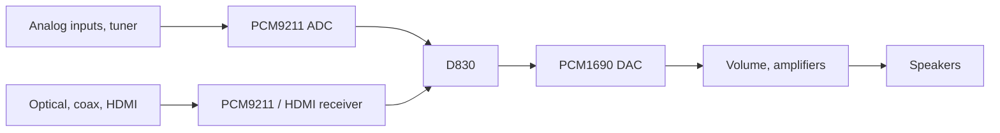

# Onkyo "no sound": the DSP chip and the NAND

Onkyo receivers with the D830 chip (TX-NR515, TX-NR616, TX-NR717, their
Integra twins and others) tend to end up the same way: receiver powers on,
display and menus work, maybe HDMI video still passes through, but there's
no sound from any input. Sometimes it hangs at power on, or network stops
working first. Usually it gets blamed on the "DTS chip" or the "HDMI board".
Here's what I found.

## What the D830 does

The chip people call the DTS chip is a Texas Instruments **D830** (full
marking e.g. D830K013BZKB4 or D830K013DZKB4). It is not a DTS decoder: it
is a general processor with an ARM9 core and a C674x DSP core, and Onkyo's
firmware on it does the decoding (Dolby, DTS), all the sound processing and
the network features.

It sits in the middle of every audio path:

Even analog inputs are digitised and sent through the D830 before they get
to the DAC. On top of that, the receiver's main MCU talks to the D830 over
SPI and waits for it: until the DSP side answers correctly, the MCU keeps the
DAC muted and the speaker relays open. So when the D830 or its firmware
stops working, everything goes silent, including the analog inputs.

## Why it fails

There are two separate problems and from outside they look the same.

### The D830 itself

The chip does not die all at once. What wears out first seems to be the
I/O buffers, the circuits that drive the pins. Once they fail the chip can
no longer reliably set its pins high or low, so it cannot run the SDRAM, read
the NAND or talk to the MCU, even though the core inside is fine. Reflowing
the chip sometimes brings it back for a while, but that does not fix wear,
and a heatsink does not help either. Running it at a slightly lower I/O
voltage (3.1 V instead of 3.3 V) may slow the wear down.

The letter before ZKB is the silicon revision. The early B parts
(D830K013BZKB4) are the ones that fail, revision D (D830K013DZKB4) is the
fixed one. You can't buy a D830 though - TI only sold it to Dolby licensees,
so what's for sale are pulls from scrap boards.

The **OMAP-L137** is the same chip: same core, same 256-ball package and
pins, and it's sold in the same revision D, new, e.g. **OMAPL137DZKB4**.
Take the 4 speed grade (456 MHz) like the D830's ZKB4 - Onkyo runs it at
400 MHz, and the 3 parts (OMAPL137DZKB3) are rated 375 MHz. It replaces the
D830 directly. The stock firmware boots on it, but Onkyo's DSP firmware
does not run.

### The NAND flash

The firmware lives in a 64 MiB NAND flash chip with 512-byte pages. These
chips are old enough that their contents rot: bits flip, and once a block
has more errors than the error correction can fix, a part of the firmware
is gone. On one receiver here the main audio program was damaged that way:
the receiver started, then hung while bringing up the audio, with no sound.

Replacing the NAND is harder than it sounds:

- 512-byte-page NAND is no longer made, and many chips sold as such are
  fakes: they read and write fine in a programmer but do not answer the
  D830 properly.
- The D830 boot ROM expects its own ECC layout in the spare bytes of the
  boot pages (4-bit Reed-Solomon, parity in bytes 6-15). Ordinary flash
  tools, and even Onkyo's own Linux, do not write that layout, so a correct
  copy of the data still does not boot.
- Modern NAND has 2 KiB or 4 KiB pages, and the stock firmware only works
  with 512-byte pages.

## What you can do

| problem | fix |
|---|---|
| NAND contents damaged, chip still good | Restore a backup with [dspboot](recovery.md), byte for byte with the right ECC |
| NAND worn out | Replace it with a 2 KiB or 4 KiB page chip and run OSIRIS ([which chips](dspboot.md#which-nand-chips-work)) |
| D830 failing | Replace it with an OMAP-L137 and run OSIRIS |
| Stock firmware gone, no backup | Run OSIRIS |

OSIRIS runs on both the D830 and the OMAP-L137 and on 512 B, 2 KiB and
4 KiB page NAND. It does not decode Dolby or DTS;
[Features](features.md) lists what works.

## Bypassing the DSP

In principle a receiver with a dead D830 could play stereo without it: the
PCM9211's output carries the analog inputs and the tuner as I2S, and the
PCM1690 takes I2S, so the PCM9211 data and clock lines could be wired
straight to the DAC's front-channel input. That alone would not be enough,
because the MCU only unmutes the DAC and closes the speaker relays after
the DSP side has done its handshake over SPI and keeps answering. A
bypass would need a small microcontroller that speaks that protocol in the
D830's place, which is what mcud does
([mcu-protocol.md](mcu-protocol.md)).
