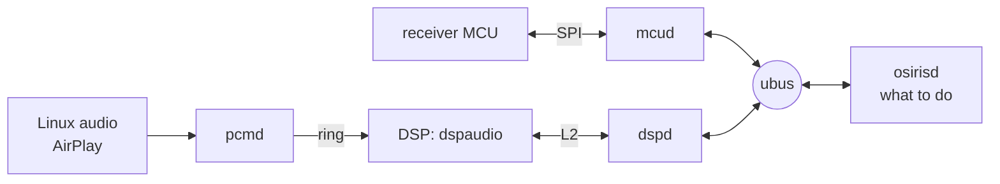

# Services

The programs that make the board work as the receiver's DSP. They run on
the receiver's Linux and talk to each other over
[ubus](https://openwrt.org/docs/techref/ubus):



| service | what it does |
|---|---|
| [mcud](../services/mcud/) | the link to the receiver's main MCU: answers it, reports what it says |
| [dspd](../services/dspd/) | loads and runs the DSP firmware, sets its gains and routing, owns the mute lines |
| [dspaudio](../services/dspaudio/) | the DSP firmware: moves the audio from the inputs to the DAC outputs |
| [osirisd](../services/osirisd/) | the policy: decides what happens when the MCU reports something |
| [pcmd](../services/pcmd/) | plays audio from Linux on the NET input: PCM from a pipe into the DSP's ring |

All decisions are in osirisd, a LuaJIT script you can edit on the receiver
itself; mcud and dspd carry out its calls and report events, and pcmd plays
what comes down its pipe.

`/etc/init.d/S10osiris` starts them at boot, before the network. They log to syslog (`logread`);
started by hand from a terminal, they log there instead.

## mcud

The receiver's MCU runs the front panel, the remote, the inputs and the
amplifiers, and expects a DSP on the other end of an SPI link. mcud is that
other end: it does the start-up handshake, answers what needs an answer at
once (versions, stream status, levels) and turns everything else into
events.

```sh
ubus listen                       # watch the events
ubus call mcu status              # handshake stage, model, the settings it knows
mcud -v                           # (with S10osiris stopped) log every frame
```

| event | when |
|---|---|
| `mcu.ready` | handshake done, with the receiver model |
| `mcu.display` | DISPLAY on NET changed the front panel mode: `name` ("AirPlay" and the album), `text` (title and artist) or `meter` (levels) |
| `mcu.volume` | volume changed, in 0.01 dB (the MCU applies it itself) |
| `mcu.input` | input or stream format changed |
| `mcu.listening_mode` | listening mode changed: `mode` (the MCU's byte, codes in [mcu-protocol.md](mcu-protocol.md)) and `name` (`plii_movie`, `all_ch_stereo`, ...) |
| `mcu.tone` | front bass and treble changed, in dB |
| `mcu.equalizer` | manual equalizer on or off, and the band levels |
| `mcu.audyssey` | Dynamic EQ, its reference offset, Dynamic Volume |
| `mcu.av_sync` | A/V sync, in ms |
| `mcu.distance` | speaker distances changed, in cm per speaker (also in `mcu status`) |
| `mcu.network` | the network menu asks for the settings; answer with `ubus call mcu network` |
| `mcu.power` | the receiver goes to standby (`off`) or resets (`reset`); confirm with `ubus call mcu power` |
| `mcu.speakers` | speaker setup: which speakers there are, large or their crossover in Hz, subwoofers, LFE low pass, double bass, what the surround back amplifiers drive |
| `mcu.lfe_level` | LFE level per source format, in dB |
| `mcu.testtone` | level calibration picked a channel (`fl`, `c`, `fr`, `sr`, `sbr`, `sbl`, `sl`, `sw`, `fhl`, `fhr`, `fwl`, `fwr`) |
| `mcu.update` | the receiver's update screens: `check` for an update, `download` it, `install` it; answer with `ubus call mcu update` |
| `mcu.iscp` | ISCP text commands, e.g. `!1MVL21` |
| `mcu.frame` | anything not decoded yet, as raw bytes |

dspd sends `dsp.ready` when it has started the DSP; osirisd then sets it up
again. The hotplug helper sends `osiris.media` (`dir`, `present`) when USB
storage is mounted or goes, and `osiris.update` (`version`, `path`) for an
update bundle on it.

[mcu-protocol.md](mcu-protocol.md) has everything known about the
protocol: framing, timing, the start-up sequence and every command.

## dspd and dspaudio

dspd copies the DSP firmware (`/usr/lib/osiris/dspaudio.bin`) into the DSP's
memory, starts it and releases the mute lines once it runs. The two share a
block of DSP memory ([dspaudio.h](../services/dspd/dspaudio.h)): the DSP reports its
state and input levels there, dspd writes the gains, filters and delays it
works out from the `dsp set` values below.

```sh
ubus call dsp status                              # state, counters, input peaks, all settings
ubus call dsp set '{"mute": true}'
ubus call dsp set '{"volume": -600}'              # gain in 0.01 dB, 0 = unity
ubus call dsp set '{"outputs": "all"}'            # "front", "all" (stereo everywhere), "mono" or "multichannel"
ubus call dsp set '{"bass": 4, "treble": -2}'      # dB, -12..+12
ubus call dsp set '{"testtone": "fl", "testtone_level": -30}'  # pink noise on one output, dBFS RMS; "off" stops it
ubus call dsp set '{"distances": {"fl": 300, "c": 250}}'  # cm; nearer speakers are held back, 0 = not known
ubus call dsp set '{"surround": "movie"}'           # surround from stereo: "movie", "music", "game" or "off"
ubus call dsp set '{"reverb": "hall"}'              # with surround on: "hall", "theater", "club", "studio", "tv" or "off"
ubus call dsp set '{"crossover": {"fl": 80, "c": 80}, "subwoofer": true, "sub_lowpass": 120}'  # Hz, 0 = large / no low pass
ubus call dsp set '{"double_bass": true, "absent": ["sbl", "sbr"]}'  # large fronts' bass to the sub too; outputs without a speaker
ubus call dsp set '{"input": "digital"}'           # "analog", "digital" (HDMI's left and right come swapped), "multichannel" (PCM from HDMI) or "network" (pcmd's ring)
ubus call dsp set '{"lfe_level": -10}'            # dB on top of the LFE channel's +10, -100 = off
ubus call dsp set '{"eq": {"fl": [0, 0, 3], "sw": [5]}}'  # dB per band from 25 Hz up (25, 40, 63 ... 16k), at most 6 bands per output
ubus call dsp set '{"av_sync": 200}'              # ms every output is held back, in SDRAM above Linux (mem=56M)
ubus call dsp set '{"loudness": 6}'               # dB of bass boost on every output (Dynamic EQ), -1 = off
ubus call dsp set '{"dynamic_volume": 2}'         # Dynamic Volume: 0 off, 1 light, 2 medium, 3 heavy
ubus call dsp set '{"fs": 44100}'                 # the source's sample rate, Hz: filters, delays and times are worked out for it
ubus call dsp set '{"back_fill": true}'           # multichannel without surround back: the surround back speakers repeat the surrounds
ubus call dsp set '{"meter": true}'               # dsp.meter events ten times a second: the front pair as played, RMS and peak in dBFS
```

dspaudio takes the I2S input from the PCM9211 (the tuner and analog inputs
through its ADC, or a digital input) and writes it to the PCM1690 DAC, four
serial lines of two channels each. With multichannel PCM from HDMI the
PCM9211 brings the front pair and the HDMI receiver the rest: LFE and centre
on AXR1_5, the surrounds on AXR1_8, the surround back pair on AXR1_9. In
"multichannel" each goes to its own output, and the channels of speakers set
to none are folded onto the ones there are; the other modes mix it down to
stereo first. Dolby and DTS (IEC 61937) it cannot decode: it keeps the
outputs silent while they play, and `dsp status` names the format in
`bitstream` (`none`, `ac3`, `dts`, `eac3` or `other`). It is built with dspboot's C6000
toolchain (`make dspaudio`).

## pcmd

pcmd reads 16-bit stereo PCM from the pipe `/var/run/pcm`, resamples it
to 48 kHz and writes it into a ring of 4096 frames in the DSP's shared RAM
(`struct dspaudio_ring` in [dspaudio.h](../services/dspd/dspaudio.h)).
When dspd's input is `network`, the DSP takes the front pair from the ring
instead of the McASP, one frame per sample period; the rest of the
processing is the same as for any other input. Writing waits while the ring
is full, so the DSP's clock sets the pace. SIGUSR1 drops what is queued in the pipe and
the ring, so a pause takes effect at once.

```sh
pcmd [-r rate] [path]    # default 44100 Hz, /var/run/pcm
cat music.raw > /var/run/pcm
```

AirPlay: shairport-sync (`/etc/init.d/S50airplay`, `/etc/shairport-sync.conf`)
announces the receiver under its host name and writes into the same pipe.
The AirPlay volume slider sets the receiver's volume (osirisd).

## osirisd

What it does today:

- names the system after the receiver model the MCU reports (host name and
  `/data/osiris/state`, unless `/data/etc/hostname` exists)
- makes the receiver show "OSIRIS <build>" as its DSP version
- picks the speakers from the listening mode (by the name of its ISCP code,
  tables `MODE_OUTPUTS`, `MODE_SURROUND`, `MODE_REVERB`):
  - All Ch Stereo plays stereo on every speaker, Full Mono mono on every
    speaker
  - Surround, Dolby PLII (also PLIIz Height and the THX and Audyssey DSX
    versions), DTS Neo:6, THX Cinema, Music and Games and Neural Surround
    make surround from stereo with the movie, music or game preset
  - the sound field modes do too and add a room: Orchestra a hall, Unplugged
    a club, Studio-Mix a studio, Film, Musical and Action a theatre, TV Logic
    a small room
  - everything else, Theater-Dimensional, Enhanced, Mono Movie, THX Surround
    EX and THX U2 among them, plays on the front pair
  - with multichannel PCM from HDMI the source plays as it is in every mode
    but Stereo, All Ch Stereo and Full Mono, which fold it down
- plays pink noise on the channel level calibration asks for (front high
  and wide on the surround back pair)
- passes the receiver's bass and treble to the DSP and keeps them in the
  state file
- passes the speaker setup to the DSP: small speakers' bass goes to the
  subwoofer at their crossover, or to the front pair when there is none;
  missing speakers get nothing (no centre: the
  voice stays in the fronts), and the surround back outputs take the
  crossover and distance of what the receiver's layout puts there (surround
  back, front high or front wide)
- passes the speaker distances to the DSP and keeps them in the state file
- passes the equalizer, A/V sync, Dynamic EQ (from the volume) and Dynamic
  Volume to the DSP
- tells the DSP the input and the source's sample rate, and the LFE level
  for multichannel PCM
- with 5.1 and surround back speakers, has them repeat the surrounds (not
  in Direct and Pure Audio)
- plays the ring (pcmd, AirPlay) on the NET input, with the level meter on
- reads shairport-sync's metadata pipe: the track and the play state go to
  the front panel, and a pause or skip makes pcmd drop its queued audio
- switches the receiver to NET when an AirPlay sender starts or resumes
  playing
- sets the receiver's volume from the AirPlay slider: the lowest step at
  the bottom, `airplay_max_db` at the top (-40 dB unless a line such as
  `airplay_max_db=-30` in `/data/osiris/state` says otherwise, at most 0)
- keeps the front panel mode DISPLAY picked in the state file
- answers the network menu with the address, link state and MAC of eth0
- offers an update bundle of another version on a USB stick when the
  receiver asks for updates: the receiver shows its update notice, and its
  update screens run `osiris-upgrade` with progress
- syncs before the receiver switches the board off; a factory reset from the
  receiver's menu wipes `/data` and reboots

To try a change, copy the script to `/tmp`, stop the running one and start
the copy from the terminal:

```sh
start-stop-daemon -K -p /var/run/osirisd.pid
/tmp/osirisd
```

## Building

`make buildroot` builds all five into the root file system and the update
bundle, and always rebuilds them, so a change here only needs that.
`make dspaudio` builds the DSP firmware alone.
